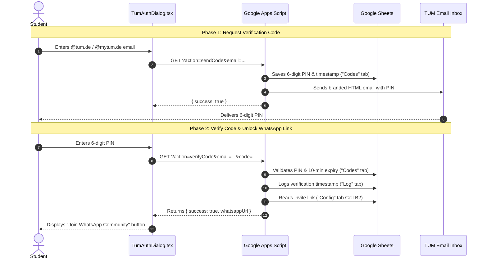

# TUM Email Verification & WhatsApp Community Integration

This directory contains the Google Apps Script backend code that enables the TUM email verification functionality.

---

## 🏗 How the Website ↔ Apps Script Connection Works

1. **Requesting Code (`action=sendCode`)**:
   - The user enters their official TUM student email (`@tum.de` or `@mytum.de`).
   - The frontend calls the deployed Apps Script URL via `GET` request.
   - Apps Script verifies the email domain, generates a random 6-digit PIN, saves it to the `Codes` tab with a timestamp, and sends an automated email from `womenincstum@gmail.com`.

2. **Verifying Code (`action=verifyCode`)**:
   - The user inputs the 6-digit code in the modal.
   - Apps Script checks the `Codes` tab to ensure the PIN matches and was issued within the last 10 minutes.
   - Upon successful verification:
     - Apps Script logs the verification timestamp to the `Log` tab.
     - Apps Script reads the community link from the `Config` tab.
     - Apps Script returns `{ success: true, whatsappUrl: "https://chat.whatsapp.com/..." }`.
   - The frontend unlocks the **"Join WhatsApp Community"** button and persists the verified session in `localStorage`.

---

## 🔄 Finding, Updating and Deploying the Apps Script

Because the script sends emails from the official club account, updates must be done while logged into **`womenincstum@gmail.com`**:

1. **Find the Script & Spreadsheet**:
   - Log into Google with **`womenincstum@gmail.com`**.
   - Go to **[script.google.com](https://script.google.com)**.
   - Open the "whatsapp email" Web App project.
   - *(Tip: To open the linked spreadsheet, click the "Open Sheet" button that appears when hovering over the project).*
2. **Update WhatsApp Link**: 
   - Whenever the community admin resets the WhatsApp invite link, manually update the link in the "Config" tab of the connected spreadsheet (**Cell B2**).
3. **Update Code**:
   - In the Apps Script editor, replace the contents of `Code.gs` with the updated code from [`google-apps-script/Code.gs`](./Code.gs) and save the project.
4. **Deploy a New Version**:
   - Click **Deploy > Manage deployments** (top-right).
   - Click the **Pencil (Edit)** icon next to the active Web App deployment.
   - In the **Version** dropdown, select **New version**.
   - Ensure settings remain:
     - **Execute as**: `Me (womenincstum@gmail.com)`
     - **Who has access**: `Anyone`
   - Click **Deploy**.
5. **Authorize Permissions**: If prompted by Google, click **Review permissions** and select **Allow** to authorize email sending and spreadsheet access.
